# Kkaeal

> A free Windows game where pixel creatures live in the corner of your screen. Catch them, raise them, send them into gyms. No game window, it runs while you work.

- Headline number: v0.3.4 beta · Windows · Mac · free
- Rendered page: https://aitryed.com/en/built/moon-studio/pixling/
- Other language: https://aitryed.com/ko/built/moon-studio/pixling/index.md
- Site guide for agents: https://aitryed.com/en/llms.txt

---

<header class="k-top">

Kkaeal

A Pokémon × Digimon Tamagotchi growing on your monitor

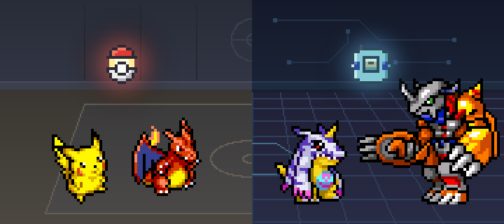
All hidden. Press \ again to bring them back.

</header>
<section class="k-getbox" aria-label="Download">

While you work, they wander around, fight and grow on their own. A free Windows game: catch them and raise them.

v0.3.4 beta · about 86 MB · free

<a class="k-btn" href="https://github.com/nobles92ts-ship-it/pixling-download/releases/latest/download/Kkaeal.zip">Download free<small>Windows</small></a><a class="k-btn" href="https://github.com/nobles92ts-ship-it/pixling-download-mac/releases/latest/download/Kkaeal-macOS-arm64.dmg">Download for Mac<small>Apple Silicon · macOS 14+</small></a>

The phone version is in progress. For now, <b>open this page on a PC</b> to download.<button type="button" id="k-copy" data-done="Copied">Copy link</button>

</section>
<dl class="k-facts">

<dt>Genre</dt><dd>Tamagotchi-style raising</dd>

<dt>Dex</dt><dd>921 species</dd>

<dt>Language</dt><dd>Korean · English</dd>

<dt>Platform</dt><dd>Windows PC · Mac<small>Mac: Apple Silicon · macOS 14+ · Android · iOS in progress</small></dd>

</dl>
<section class="k-sec" id="k-preview">

Preview

<h2>See it move first</h2>
<ul class="k-reel">
<li><a href="https://www.instagram.com/munbanggu100w/reel/DeTHl7sO_cI/" target="_blank" rel="noopener">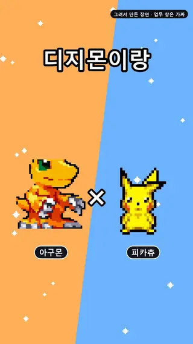Partner being cute</a></li>
<li><a href="https://www.instagram.com/munbanggu100w/reel/DeEMfVxB2DU/" target="_blank" rel="noopener">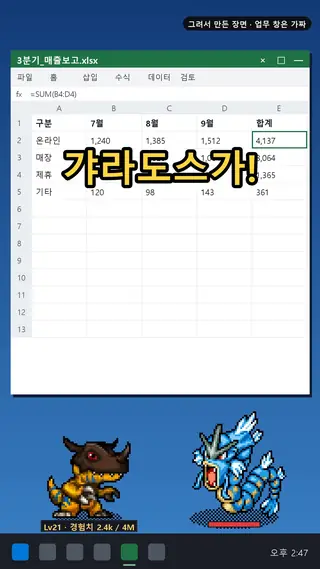A Gyarados at work</a></li>
<li><a href="https://www.instagram.com/munbanggu100w/reel/DeIqUwLBTDd/" target="_blank" rel="noopener">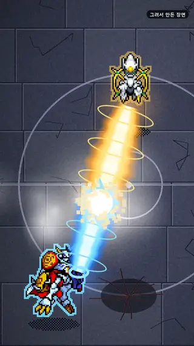Tower floor 100</a></li>
<li><a href="https://www.instagram.com/munbanggu100w/reel/DeEyZ4RhnpD/" target="_blank" rel="noopener">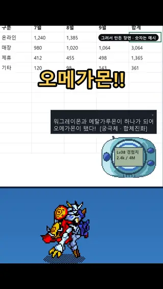Digivice and DNA Digivolve</a></li>
</ul>

Each one opens a short clip on Instagram. The captions in the clips are in Korean.

</section>
<section class="k-sec" id="k-info">

Game info

<h2>No window, right on your monitor</h2>

The creatures walk around near the taskbar. One press of <kbd>\</kbd> hides everything, and a second press brings it back. Developers who type it all day can switch to another key in the settings.

<h3>Catch</h3>
Grab the wild ones walking by: a Poké Ball for Pokémon, a Digivice for Digimon.

<h3>Raise</h3>
Typing and clicking become experience, and your partner digivolves all the way to Mega.

<h3>Send</h3>
Build a team for the gyms and the tower. There are 32 gyms on each side.

<ul class="k-mons"><li>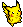Pikachu</li><li>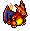Charizard</li><li>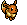Eevee</li><li>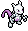Mewtwo</li><li>Gengar</li><li>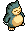Snorlax</li><li>Agumon</li><li>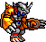WarGreymon</li><li>Gabumon</li><li>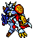Omegamon</li><li>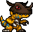Greymon</li><li>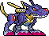MetalGarurumon</li></ul>

627 Pokémon · 294 Digimon. Dex numbers are as of v0.1.6.

</section>
<section class="k-sec" id="k-env">

Download

<h2>Where to get it, what it runs on</h2>
<ul class="k-rows">
<li>
<b>GitHub</b>Kkaeal.zip · about 78 MB
<a class="k-rowbtn" href="https://github.com/nobles92ts-ship-it/pixling-download/releases/latest/download/Kkaeal.zip">Download ↓</a></li>
<li>
<b>Mac</b>Kkaeal-macOS-arm64.dmg · v0.3.3.1 · about 109 MB · Apple Silicon (M1+) · macOS 14 or later
<a class="k-rowbtn" href="https://github.com/nobles92ts-ship-it/pixling-download-mac/releases/latest/download/Kkaeal-macOS-arm64.dmg">Download ↓</a></li>
<li>
<b>itch.io</b>If the link above doesn't work
<a class="k-rowbtn k-ghost" href="https://nobles92ts-ship-it.itch.io/pixling">Open ↗</a></li>
</ul>
<table class="k-env">
<tbody>
<tr><th scope="row">Windows PC</th><td class="k-yes">Works</td></tr>
<tr><th scope="row">Mac</th><td class="k-yes">Works<small>Apple Silicon (M1+) · macOS 14 or later. Intel Macs not yet.</small></td></tr>
<tr><th scope="row">Android · iOS</th><td class="k-wip">In progress</td></tr>
<tr><th scope="row">Install</th><td>Not needed<small>Unzip and run 깨알.exe.</small></td></tr>
<tr><th scope="row">Save</th><td>Survives new versions<small>Stored separately in <code>%APPDATA%\Pixling</code>.</small></td></tr>
<tr><th scope="row">First launch</th><td>A blue box appears once<small>The file has no code signature. Nothing is broken.</small></td></tr>
<tr><th scope="row">Antivirus</th><td>Not measured yet</td></tr>
</tbody>
</table>
<h3 class="k-h3">Versions</h3>
<ul class="k-rows k-vers">
<li>
<b>v0.3.4 <i>Latest</i></b>86 MB · 2026-11-10 · League results right away · Quest hint fix
<a class="k-link" href="https://github.com/nobles92ts-ship-it/pixling-download/releases/tag/v0.3.4">What's new ↗</a></li>
<li>
<b>v0.3.3</b>86 MB · 2026-11-10 · Conquest League · 20 tickets a day · League map
<a class="k-link" href="https://github.com/nobles92ts-ship-it/pixling-download/releases/tag/v0.3.3">What's new ↗</a></li>
<li>
<b>v0.3.2</b>86 MB · 2026-11-08 · Ranked Battles on one screen · Friends · Notice board
<a class="k-link" href="https://github.com/nobles92ts-ship-it/pixling-download/releases/tag/v0.3.2">What's new ↗</a></li>
<li>
<b>v0.3.1</b>86 MB · 2026-11-07 · Auto-battle ON/OFF · New ranking season table
<a class="k-link" href="https://github.com/nobles92ts-ship-it/pixling-download/releases/tag/v0.3.1">What's new ↗</a></li>
<li>
<b>v0.3.0</b>86 MB · 2026-11-06 · One-window hub · Pixel effects · Fractional power
<a class="k-link" href="https://github.com/nobles92ts-ship-it/pixling-download/releases/tag/v0.3.0">What's new ↗</a></li>
<li>
<b>v0.2.9</b>78 MB · 2026-11-03 · Link Battle fix
<a class="k-link" href="https://github.com/nobles92ts-ship-it/pixling-download/releases/tag/v0.2.9">What's new ↗</a></li>
<li>
<b>v0.2.8</b>78 MB · 2026-11-03 · Quests · Dex «View moves» · Ranking podium
<a class="k-link" href="https://github.com/nobles92ts-ship-it/pixling-download/releases/tag/v0.2.8">What's new ↗</a></li>
<li>
<b>v0.2.7</b>72 MB · 2026-11-02
<a class="k-link" href="https://github.com/nobles92ts-ship-it/pixling-download/releases/tag/v0.2.7">What's new ↗</a></li>
</ul>
</section>
<section class="k-sec k-more" id="k-help">

How to run it

<ol class="k-steps">
<li><i>1</i>Unzip the download</li>
<li><i>2</i>Double-click <b>깨알.exe</b> in the <b>깨알</b> folder</li>
<li><i>3</i>If a blue box appears: <b>More info → Run anyway</b></li>
</ol>

Windows protected your PC

<u>More info</u><em>① click here</em>

Run anyway<em>② and this button appears</em>Don't run

Running it on a Mac

<ol class="k-steps">
<li><i>1</i>Open the DMG and move <b>Kkaeal.app</b> to <b>Applications</b></li>
<li><i>2</i>Launch Kkaeal from Applications</li>
<li><i>3</i>If macOS blocks it as from an unidentified developer, try once, then <b>System Settings → Privacy &amp; Security → Open Anyway</b></li>
</ol>
This is a personal release without an Apple Developer ID signature or notarization, so you approve it once yourself. You don't need to turn off any Mac-wide security setting. To grow from typing and clicking, allow Input Monitoring from the menu-bar icon → <b>macOS input permission…</b> (only counts are kept). Mac builds don't self-update: download the new build here and replace the app. Saves stay in <code>~/Library/Application Support/Pixling</code>.

More to do

<ul class="k-list">
<li><b>Life Yard</b>Seat up to 10 creatures you aren't using and they work by type for gold, only while you're active at the PC.</li>
<li><b>Shop gacha</b>Spend that gold on pulls (300 a pull) to fill the Dex.</li>
<li><b>Daily gift</b>Once a day, five minutes after you start, a creature walks in wearing a ribbon. Click it to keep it.</li>
<li><b>Mini-games</b>Gomoku against your partner · Picture match · a silhouette quiz.</li>
<li><b>Link Battle</b>Turn your team into one line of code and fight a friend 10 vs 10. Turn it on to join the online ranking (off by default).</li>
</ul>

Updates

At start the game asks whether a new version exists, and downloads only if you agree. If you don't want to wait, press «⬆ Update» in the menu. Versions older than v0.1.3 get no notice, so download from this page once and overwrite.

What goes over the internet

<ul class="k-list">
<li><b>Version check</b>Asks GitHub once at start. It sends only its version number.</li>
<li><b>Attendance signal</b>While running, once a day it sends an anonymous number, the version and quest stage. There is no setting to turn this off (from v0.2.8).</li>
<li><b>Event check</b>At start and every hour it asks whether an event is on, and sends nothing (from v0.2.8).</li>
<li><b>Ranking</b>Only players who turn on Ranking talk to the ranking server.</li>
</ul>

Is it reading my keystrokes?

No. It only counts how many times something was pressed, and can't tell which key it was. Each key press is worth 1 experience point; each mouse click is worth 2.

Try it on this page. This box counts the same way, but it isn't the game, and it sends nothing anywhere.

<b id="k-nk">0</b>Key presses

<b id="k-nm">0</b>Mouse clicks

<b id="k-nx">0</b>Experience

Credits and copyright

A non-commercial fan game, not an official game. The Digimon sprites belong to Bandai; the Pokémon sprites belong to Nintendo, Game Freak and Creatures. The full notice is in the in-game credits window and in <code>OUTPUT_NOTICE.md</code> inside the zip.

</section>

<a class="k-get" href="https://github.com/nobles92ts-ship-it/pixling-download/releases/latest/download/Kkaeal.zip">Download · free</a>
<nav aria-label="On this page">
<a href="#k-preview">Preview</a>
<a href="#k-info">Game info</a>
<a href="#k-env">Download</a>
<a href="#k-help">Help</a>
</nav>

<button type="button" class="k-hidebtn js-hide" aria-pressed="false"><kbd>\</kbd> Hide</button>

## The detailed record starts here

## Production now uses a v3 director, owners, and verifier

This describes the operating records checked on 2026-10-19. A main director manages the board and cards for the game. Each feature owner handles the scoped design details, code, data, and headless tests. A different agent verifies the integrated build. Claude or Codex can take over the director role.

Art01 handles characters, motion, and arena artwork; Art02 handles skills, effects, and presentation. Some tasks split a Claude draft from Codex production work. Delivering artwork to staging, integrating it, and checking the integrated result are separate steps. The full process is described in [MOON Studio v3](/en/built/moon-studio/index.md).

The [studio coordination update](/en/built/moon-studio/index.md) keeps the director, owners assigned to cards, fresh verifiers, and persistent art sessions while strengthening handoffs, duplicate prevention, and resource reservations. Extra development or QA coordinators require a demonstrated bottleneck. On 2026-10-22 the Kkaeal director seat changed hands through this guard's handover, and that director shipped v0.2.0 (2026-10-23), v0.2.1 (2026-10-24), v0.2.2 (2026-10-26), v0.2.3 (2026-10-26), v0.2.4 (2026-10-27), v0.2.5 (2026-10-28), v0.2.6 (2026-10-28), v0.2.7 (2026-11-02), v0.2.8 (2026-11-03) and v0.2.9 (2026-11-03).

| Version | State confirmed on 2026-10-28 |
|---|---|
| v0.3.4 | Latest public download (2026-11-10); the download instructions on this page describe this release; the Mac build is 0.3.3.1 in the separate Mac repository |
| v0.3.3 | Previous public release (2026-11-10); Mac build 0.3.3.1 (same content plus a fix for the Mac first-launch notice) |
| v0.3.2 | Previous public release (2026-11-08) |
| v0.3.1 | Previous public release (2026-11-07) |
| v0.3.0 | Previous public release (2026-11-06) |
| v0.2.9 | Previous public release (2026-11-03) |
| v0.2.8 | Previous public release (2026-11-03) |
| v0.2.7 | Previous public release (2026-11-02) |
| v0.2.6 | Previous public release (2026-10-28) |
| v0.2.5 | Previous public release (2026-10-28) |
| v0.2.4 | Previous public release (2026-10-27) |
| v0.2.3 | Previous public release (2026-10-26) |
| v0.2.2 | Previous public release (2026-10-26) |
| v0.2.1 | Previous public release (2026-10-24) |
| v0.2.0 | Previous public release (2026-10-23) |
| v0.1.7 | Never released on its own; folded into v0.2.0 |
| v0.1.6 | Previous public release; the feature table on this page describes it |

This is a comparison of the operating board with the [public release](https://github.com/nobles92ts-ship-it/pixling-download/releases/tag/v0.3.4). I did not rerun the game's regression suite while updating this page.

## What the three-session v2 process taught about boundaries

Before the 2026-10-08 transition, three AI sessions divided the work. **Planning** owned design and specifications; **development** owned code, tests, packaging, and verification tools; **art** made the pictures. Orders arrived through specifications with acceptance conditions or messages between sessions. The following lessons belong to that earlier process.

At first the boundary looked like a **list of prohibitions**: development doesn't edit the spec, and so on. But on the day the line actually broke, nothing prohibited had happened. The development session handed planning **"the line you should add to the spec" as a ready-made quote.** It never touched the spec — but it **decided the sentence**, which is the same line crossed.

So the line was redrawn. **Measuring and handing over is development's job; deciding with that number is planning's.** "Doing this gives that value" is fine. "So let's write this in the document" is not.

The messaging itself leaked too. **Three of four messages examined at the time** went by unread. The earlier repair made **the receiving side check every turn**. v3 instead aims to reduce those cross-discipline handoffs.

## All-green checks still don't tell you whether it runs on screen

Every executable build runs four checks: was it stamped, have no commits landed since the build, is nothing left uncommitted, and was the game not running while it was built. One day all four were green, and the intended commit was confirmed to be in the build.

Then the game was launched, and the new feature **didn't show at all.** Only the code that positions the fighters had shipped. **The battle animation itself was missing entirely.**

The four checks were perfect at **"what went in"** and looked at none of **"does it run on screen."** Those are different questions. Since then, before saying a feature works, the rule is **to launch it and look at that screen** — and if it can't be launched, to make the check look at the resulting screen before saying anything.
