# 깨알

> 모니터 구석에 사는 픽셀 생물을 잡고, 키우고, 체육관에서 싸우게 하는 Windows 게임. 창 없이 일하는 내내 켜 두는 무료 육성 게임입니다.

- 수치: v0.2.9 베타 · Windows · 무료
- 사람이 보는 화면: https://aitryed.com/ko/built/moon-studio/pixling/
- 반대 언어: https://aitryed.com/en/built/moon-studio/pixling/index.md
- 이 사이트 안내(AI용): https://aitryed.com/ko/llms.txt

---

<header class="k-hero">

깨알

내 모니터에서 자라는 포켓몬 × 디지몬 다마고치

일하는 동안 알아서 돌아다니고, 싸우고, 자랍니다. 잡고 키우는 무료 Windows 게임이에요.

<a class="k-btn" href="https://github.com/nobles92ts-ship-it/pixling-download/releases/latest/download/Kkaeal.zip">무료로 받기<small>Windows</small></a>

<b>Kkaeal.zip</b>v0.2.9 베타 · 약 78MB · 무료<a href="https://nobles92ts-ship-it.itch.io/pixling">안 받아지면 itch.io 에서 →</a>비영리 팬메이드입니다. 공식 게임이 아닙니다.

휴대폰에서는 실행되지 않아요. <b>PC에서 이 주소로</b> 와 주세요.<button type="button" id="k-copy" data-done="복사했어요">주소 복사</button>

<kbd>₩</kbd> 키를 눌러 보세요. 게임처럼 이 화면의 그림도 숨고, 한 번 더 누르면 돌아옵니다. 코드를 자주 치는 개발자라면 설정에서 다른 키로 바꿀 수 있어요.

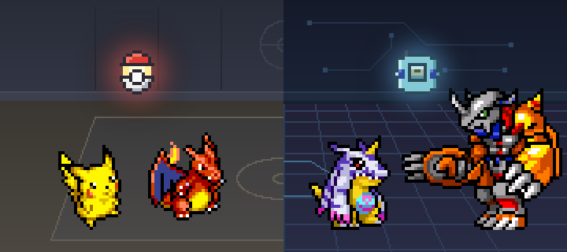
다 숨었습니다. ₩ 를 한 번 더 누르면 돌아옵니다.

</header>
<section class="k-sec" id="k-nowin">

<h2>이 게임은 화면을 차지하지 않습니다</h2>
창이 따로 없습니다. 생물이 모니터 위, 작업 표시줄 근처를 돌아다닙니다.

<button type="button" class="k-key js-hide" aria-pressed="false" aria-label="₩ 키: 그림 숨기기와 돌아오기">₩</button>
개발자분들은 설정에서 다른 키로 바꿀 수 있어요

<dl class="k-vs">

<dt>어디서</dt><dd class="k-old">게임 창 안</dd><dd class="k-new">모니터 위</dd>

<dt>언제</dt><dd class="k-old">할 때만 켬</dd><dd class="k-new">일하는 내내 켜 둠<small>시간대마다 잘 나오는 생물이 다릅니다.</small></dd>

<dt>급할 때</dt><dd class="k-old">창을 내림</dd><dd class="k-new">₩ 키 한 번에 숨고, 한 번 더 누르면 돌아옴</dd>

</dl>

숨기는 키는 설정에서 바꿀 수 있습니다. 이 키를 다른 프로그램에서 빼앗지 않기 때문에, 다른 데서 ₩ 를 쳐도 글자는 그대로 쳐지고 게임만 같이 숨습니다.

</section>
<section class="k-sec k-shots" id="k-shots">
<h2>움직이는 걸로 보면 한 번에 압니다</h2>

누르면 인스타그램 짧은 영상으로 갑니다.

<ul class="k-reel">
<li><a href="https://www.instagram.com/munbanggu100w/reel/DeTHl7sO_cI/" target="_blank" rel="noopener">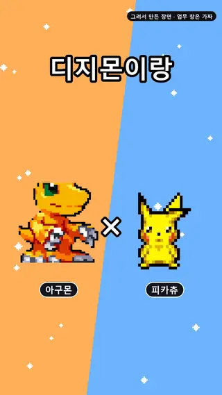애교 부리는 파트너</a></li>
<li><a href="https://www.instagram.com/munbanggu100w/reel/DeEMfVxB2DU/" target="_blank" rel="noopener">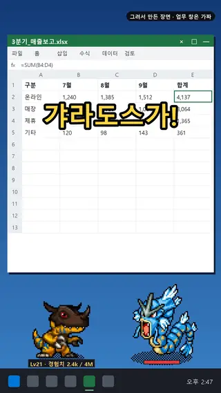출근했더니 갸라도스</a></li>
<li><a href="https://www.instagram.com/munbanggu100w/reel/DeIqUwLBTDd/" target="_blank" rel="noopener">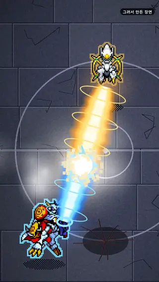탑 100층</a></li>
<li><a href="https://www.instagram.com/munbanggu100w/reel/DeEyZ4RhnpD/" target="_blank" rel="noopener">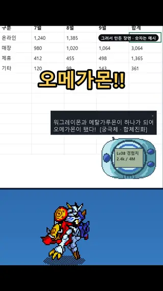디지바이스와 합체 진화</a></li>
</ul>
</section>
<section class="k-sec k-dex" id="k-dex">

921

<h2>종을 도감에 모아요</h2>
처음 잡으면 카드로 뒤집혀 나오고, 잡은 종에는 1~10 티어가 붙습니다.

포켓몬 627종
<ul class="k-mons">
<li>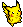피카츄</li>
<li>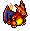리자몽</li>
<li>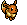이브이</li>
<li>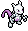뮤츠</li>
<li>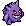팬텀</li>
<li>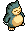잠만보</li>
<li>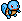꼬부기</li>
<li>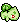이상해씨</li>
<li>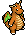망나뇽</li>
<li>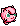푸린</li>
<li>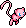뮤</li>
<li>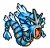갸라도스</li>
</ul>
그리고 615종 더

디지몬 294종
<ul class="k-mons">
<li>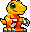아구몬</li>
<li>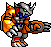워그레이몬</li>
<li>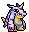파피몬</li>
<li>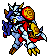오메가몬</li>
<li>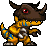그레이몬</li>
<li>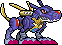메탈가루몬</li>
<li>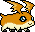파닥몬</li>
<li>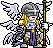엔젤몬</li>
<li>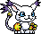가트몬</li>
<li>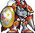듀크몬</li>
<li>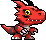길몬</li>
<li>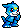브이몬</li>
</ul>
그리고 282종 더

도감 숫자는 v0.1.6 기준입니다.

</section>
<section class="k-sec k-olive" id="k-play">
<h2>셋이 중심이고, 일하는 틈에 할 거리가 둘레에 붙어 있습니다</h2>

<h3 class="k-stroke">잡기</h3>
돌아다니는 야생을 잡습니다. 포켓몬은 몬스터볼을 던지고, 디지몬은 디지바이스로 비춥니다. 탑 · 체육관 · 통신 대전 상대는 잡지 않습니다(v0.2.4 부터).

<h3 class="k-stroke">키우기</h3>
파트너가 자라서 성장기 → 성숙기 → 완전체 → 궁극체로 진화합니다.

<h3 class="k-stroke">보내기</h3>
팀을 꾸려 체육관과 탑에 보냅니다. 체육관은 포켓몬 쪽 · 디지몬 쪽이 32관씩이고, 시즌 1 한쪽을 다 깨면 더 센 시즌 2 가 열립니다. 배지를 처음 따면 «관 번호 × 50G».

그리고 둘레에

<dl class="k-around">

<dt>생활 마당</dt><dd>안 쓰는 몬스터를 10마리까지 앉히면 타입대로 일해서 골드를 법니다. 물 타입은 낚시, 전기 타입은 충전. 내가 PC 를 쓰는 동안만 벌고, 한 시간마다 번 골드를 알려 줍니다.</dd>

<dt>상점 뽑기</dt><dd>모은 골드로 뽑기를 돌려(1회 300G) 도감을 채웁니다.</dd>

<dt>매일 선물</dt><dd>하루 한 번, 첫 활동 5분 뒤 리본을 단 몬스터가 걸어옵니다. 눌러야 데려옵니다.</dd>

<dt>미니게임</dt><dd>파트너와 두는 오목(하 · 중 · 상 · 극상, 그리고 카드가 차례를 정하는 «랜덤») · 그림 맞추기 1 · 2 · 3단계 · 실루엣 맞추기.</dd>

<dt>통신 대전</dt><dd>내 팀을 코드 한 줄로 바꿔 친구와 10 대 10, 한 마리씩 1:1 로 겨룹니다. 보상은 없고, 같은 판끼리 씁니다. 참여를 켜면 온라인 랭킹에 내 팀을 올리고 다른 사람 팀에 하루 20번까지 도전합니다. 결과는 밤마다 서버가 다시 확인한 뒤 순위에 들어갑니다(v0.2.5 부터 · 처음엔 꺼져 있음).</dd>

</dl>

위 숫자는 v0.1.6 기준입니다.

</section>
<section class="k-sec k-paper" id="k-typing">

<h2>타자를 치면 자랍니다. 무엇을 쳤는지는 모릅니다</h2>

키를 한 번 누르면 경험치 1, 마우스를 한 번 누르면 2입니다.

「내 타자를 읽는 거 아니야?」

아닙니다.

이 게임이 세는 건 누른 횟수 하나뿐입니다. 키 입력을 중간에서 가로채지 않고, 아주 짧은 간격으로 「지금 눌려 있나」만 묻습니다. 이렇게 하면 글자를 되살리는 게 원리상 불가능합니다. 세이브 파일에도 숫자 두 개만 남습니다.

보안 프로그램이 이 물음까지 막는 PC 에서는 v0.1.4 부터 「마지막으로 무언가를 누른 시각」만 보고, 그 시각이 바뀔 때마다 키 한 번으로 셉니다. 이때도 어떤 키였는지는 알 수 없습니다.

생물은 내가 키보드 앞에 있을 때만 나타납니다. 조금 전에 만난 뒤로 시간이 충분히 지나고 조작도 충분히 쌓여야 다음 생물이 옵니다. 자리를 비운 사이에 쌓였다가 한꺼번에 쏟아지지도 않습니다.

지금 이 화면에서 눌러 보세요. 같은 셈법의 시험 칸이고, 게임 화면은 아닙니다. 어디로도 보내지 않습니다.

<b id="k-nk">0</b>키 누른 횟수

<b id="k-nm">0</b>마우스 누른 횟수

<b id="k-nx">0</b>경험치

<table class="k-count"><thead><tr><th scope="col">세는 것</th><th scope="col">안 세는 것</th></tr></thead><tbody>
<tr><td>키를 누른 <b>횟수</b></td><td>어떤 키였는지</td></tr>
<tr><td>마우스를 누른 <b>횟수</b></td><td>무슨 글자를 쳤는지 · 어느 창이었는지 · 커서가 어디였는지</td></tr>
</tbody></table>

</section>
<section class="k-sec" id="k-how">

<h2>받아서 켜기까지 세 번</h2><ol class="k-steps">
<li><i>1</i>받은 zip 을 풉니다</li>
<li><i>2</i><b>깨알</b> 폴더의 <b>깨알.exe</b> 를 두 번 누릅니다</li>
<li><i>3</i>파란 창이 뜨면 <b>추가 정보 → 실행</b></li>
</ol>

Windows의 PC 보호

<u>추가 정보</u><em>① 여기를 누르면</em>

실행<em>② 이 버튼이 생깁니다</em>실행 안 함

<strong>처음 켤 때 한 번 뜹니다. 고장이 아닙니다.</strong> 이 파일에 「만든 사람 도장」(코드 서명)이 없어서 뜹니다. 도장은 1년에 돈이 들고, 요즘은 도장을 받아도 이 창이 바로 사라지지 않습니다. 받는 사람이 많아져야 창이 뜨지 않게 됩니다. 그래서 무료 게임에는 붙이지 않았습니다.

</section>
<section class="k-sec k-restsec">

<h2>세이브는 따로 살아서 새 판을 받아도 남습니다</h2>

세이브는 게임 파일 옆이 아니라 <code>%APPDATA%\Pixling</code> 에 저장됩니다(폴더 이름은 옛 이름 그대로 둡니다 — 바꾸면 키우던 생물을 못 찾습니다). 새 판이 나오면 새 zip 을 받아 덮어쓰기만 하면 되고, 키우던 생물은 그대로 있습니다.

덮어쓰는 일도 대개는 게임이 해 줍니다. 켤 때 한 번 GitHub(받기 저장소)에 새 판이 있는지 묻고, 보내는 것은 판 번호뿐입니다. «받기»를 눌러 동의할 때만 받습니다. 기다리기 싫으면 메뉴 «⬆ 업데이트» 를 누르세요(v0.1.6 부터). 켜 둔 동안에는 업데이트할 때까지 디지바이스 말풍선으로 30분마다 다시 알려 줍니다(v0.2.2 부터). 이미 최신이면 그 창에 그 판에서 달라진 것을 몇 줄로 보여 줍니다(v0.2.3 부터).

이 알림은 v0.1.3 부터 들어 있습니다. 그보다 옛 판을 쓰고 계시면 알림이 오지 않으니, 한 번만 이 페이지에서 받아 덮어써 주세요.

<h2>아직 못 하는 것</h2><ul class="k-cant">
<li><b>Mac · 휴대폰에서 하기</b>Windows 창 기능으로 돌아갑니다.</li>
<li><b>파란 창 없애기</b>코드 서명이 없습니다.</li>
<li><b>백신 반응 확인</b>「지금 눌려 있나」를 묻는 방식을 백신이 어떻게 보는지는 아직 재 보지 않았습니다.</li>
</ul>

</section>
<section class="k-sec k-end" id="k-get">

<h2>오늘부터 모니터에서 같이 놀아요</h2>

<a class="k-btn" href="https://github.com/nobles92ts-ship-it/pixling-download/releases/latest/download/Kkaeal.zip">무료로 받기<small>Windows</small></a>
Kkaeal.zip · 무료 <a href="https://nobles92ts-ship-it.itch.io/pixling">안 받아지면 itch.io 에서 →</a>

</section>

이름은 두 말에서 왔습니다. 작고 촘촘하다는 「깨알 같다」, 그리고 이 게임의 생물이 모두 태어나는 방법인 「알을 깨다」. 비영리 팬메이드입니다. 디지몬 도트는 반다이, 포켓몬 도트는 닌텐도·게임프리크·크리처스의 것입니다. 전문은 게임 안 「출처와 저작권」 창과 zip 안의 <code>OUTPUT_NOTICE.md</code> 에 있습니다.

<a class="k-get" href="https://github.com/nobles92ts-ship-it/pixling-download/releases/latest/download/Kkaeal.zip">받기 · 무료</a>
<nav aria-label="이 화면 안내">
<a href="#k-nowin">창 없음</a>
<a href="#k-shots">영상</a>
<a href="#k-dex">도감</a>
<a href="#k-play">할 거리</a>
<a href="#k-typing">타자</a>
<a href="#k-how">켜는 법</a>
</nav>

<button type="button" class="k-hidebtn js-hide" aria-pressed="false"><kbd>₩</kbd> 숨기기</button>

## 여기부터는 자세한 기록입니다

## 현재 제작은 v3 디렉터·오너·검증관으로 돈다

2026-10-19 운영 기록 기준이다. 게임당 메인 디렉터가 보드와 작업 카드를 관리하고, 기능 오너가 카드 안의 설계 세부·코드·데이터와 창 없는 시험을 맡는다. 디렉터가 합친 판은 만든 쪽과 다른 검증관이 확인한다. 디렉터 자리는 Claude나 Codex가 이어받을 수 있다.

아트01은 캐릭터·동작과 경기장 그림을, 아트02는 기술·이펙트·연출을 맡는다. 일감에 따라 Claude 초안과 Codex 본작업을 나누기도 한다. 그림은 임시 납품 위치로 받고, 게임에 넣는 일과 넣은 판의 확인은 따로 한다. 전체 제작 흐름은 [문스튜디오 v3](/ko/built/moon-studio/index.md)에 정리했다.

[스튜디오 운영 보강](/ko/built/moon-studio/index.md)은 디렉터·카드별 오너·새 검증관·지속 아트 세션을 유지하며 인수·중복·자원 예약을 강화했다. 개발·QA 상시 조율자는 병목 확인 뒤 시범한다. 2026-10-22에 깨알 디렉터 자리를 이 가드의 인수 절차로 넘겨받았고, 그 판으로 v0.2.0(2026-10-23) · v0.2.1(2026-10-24) · v0.2.2(2026-10-26) · v0.2.3(2026-10-26) · v0.2.4(2026-10-27) · v0.2.5(2026-10-28) · v0.2.6(2026-10-28) · v0.2.7(2026-11-02) · v0.2.8(2026-11-03) · v0.2.9(2026-11-03)를 냈다.

| 판 | 2026-10-28에 확인한 상태 |
|---|---|
| v0.2.9 | 공개 받기 저장소의 최신 배포판(2026-11-03). 받기 안내 기준 |
| v0.2.8 | 이전 공개판(2026-11-03) |
| v0.2.7 | 이전 공개판(2026-11-02) |
| v0.2.6 | 이전 공개판(2026-10-28) |
| v0.2.5 | 이전 공개판(2026-10-28) |
| v0.2.4 | 이전 공개판(2026-10-27) |
| v0.2.3 | 이전 공개판(2026-10-26) |
| v0.2.2 | 이전 공개판(2026-10-26) |
| v0.2.1 | 이전 공개판(2026-10-24) |
| v0.2.0 | 이전 공개판(2026-10-23) |
| v0.1.7 | 공개하지 않고 v0.2.0에 합침 |
| v0.1.6 | 이전 공개판. 이 페이지의 기능 표 기준 |

확인은 운영 보드와 [공개 릴리스](https://github.com/nobles92ts-ship-it/pixling-download/releases/tag/v0.2.9)를 대조한 것이다. 이 글을 고치며 게임 회귀 시험을 새로 실행하지 않았다.

## v2 당시 세 세션의 경계에서 배운 것

2026-10-08 전환 전에는 AI 세션 셋이 나눠 만들었다. **기획 세션**은 설계와 기획서, **개발 세션**은 코드·시험·실행 파일과 검증 도구, **아트 세션**은 그림을 맡았다. 오더는 합격 조건을 적은 기획서나 세션 사이 메시지로 왔다. 아래는 그때의 실패에서 남긴 교훈이다.

처음에는 경계를 **금지 목록**으로 생각했다. 개발은 기획서를 고치지 않는다, 같은 식이다. 그런데 실제로 선이 무너진 날에는 금지된 일을 한 게 아니었다. 개발 세션이 기획에게 **「기획서에 넣으실 한 줄」을 인용문으로 써서** 넘겼다. 기획서를 직접 고치지는 않았지만, **쓸 문장을 정해 준 것**이라 같은 선을 넘은 것이다.

그래서 선을 다시 그었다. **재서 넘기는 것은 개발 몫, 그 숫자로 정하는 것은 기획 몫.** 「이렇게 하면 이 값이 나온다」는 되고, 「그러니 문서에 이렇게 적자」는 안 된다.

소통 자체도 새는 곳이었다. 당시 확인한 세션 사이 메시지 **네 건 중 세 건이 읽히지 않은 채** 지나갔다. 그때는 **받는 쪽이 매 턴 스스로 확인**하도록 고쳤다. v3는 이런 직군 간 전달 자체를 줄이려는 개편이다.

## 검사가 전부 초록이어도 «화면에서 도는가»는 따로 봐야 한다

실행 파일을 구울 때 검사 넷을 돌린다. 도장이 찍혔나, 구운 뒤로 새 커밋이 없나, 안 넣은 변경이 없나, 게임이 켜진 채로 굽지 않았나. 어느 날 넷 다 초록이었고, 넣으려던 커밋이 들어간 것도 확인했다.

그런데 켜 보니 새 기능이 **전혀 보이지 않았다.** 자리를 잡는 코드만 들어 있었고, **싸우는 연출은 통째로 없었다.**

검사 넷은 <strong>「무엇이 들었나」</strong>에는 완벽했고, <strong>「화면에서 도나」</strong>는 한 칸도 보지 않았다. 둘은 다른 질문이다. 그 뒤로는 기능이 «된다»고 말하기 전에 **띄워서 그 화면을 본다.** 못 띄우면, 검사가 결과 화면을 보게 만든 다음에 말한다.
